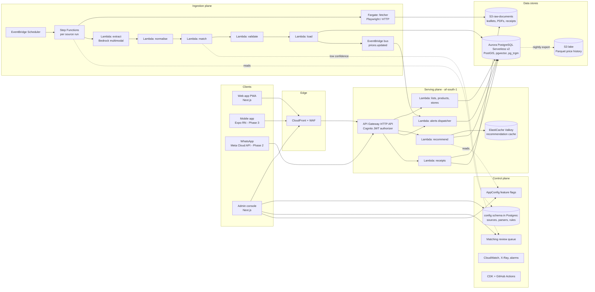
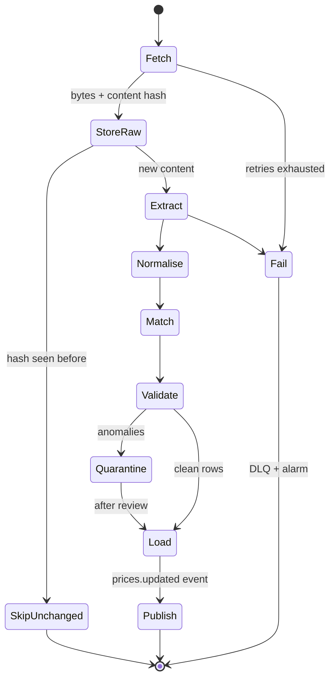

# Bala — grocery basket optimiser for South Africa
## System design: control plane and data plane

Status: concept / v0.1 design. Web first, mobile later. Region: af-south-1 (Cape Town).

---

## 0. Name

**Bala** (recommended). From *ukubala* (isiZulu/isiXhosa: to count, to calculate) and *bala* (Sesotho/Setswana: to count, to read). Two syllables, easy to say in every SA language and in English, works as a verb ("Bala your list"). Corporate enough for a B2B data product later (Bala Insights).

Tagline options: "Count on it." / "Your basket, counted." / "Shop where it counts."

Runners-up:
| Name | Meaning | Note |
|---|---|---|
| Tsela | path / route (Sesotho, Setswana) | Fits the "where to shop" routing idea; slightly harder for non-Sotho speakers |
| RandWise | English, SA currency | Instantly clear, less distinctive, hard to trademark |
| Tjek | Afrikaans slang "check" | Fun, modern, less corporate |
| Kgetho | choice (Sesotho/Setswana) | Meaningful, pronunciation barrier |

Before committing: search the CIPC trade mark register and company name register, and check domains (bala.co.za is probably taken; getbala.co.za, bala.app, balaapp.co.za are fallbacks). Not verified here.

---

## 1. Scope and phases

| Phase | Deliverable | Channel |
|---|---|---|
| 0 (weeks 1–4) | Infra, catalogue of top ~500 SKUs, leaflet ingestion for 3 chains in one metro, admin console v0 | internal |
| 1 (weeks 5–12) | Public web app: list → recommendation, price history, store picker | Web (PWA) |
| 2 | Receipt upload, watchlist alerts (email/WhatsApp), household sharing | Web + WhatsApp bot |
| 3 | Native mobile (Expo/React Native), push notifications, barcode scanning, offline list | iOS + Android |
| 4 | Retailer partnerships / affiliate ordering, premium tier, Bala Insights (B2B data) | all |

Design rule: the API and domain model are built in Phase 1 so that Phase 3 adds a client, not a backend.

---

## 2. Definitions

- **Control plane**: everything that configures and operates the system but does not sit on the user request path. Source registry, catalogue management, matching review, promo rule definitions, feature flags, store directory, pipeline orchestration state, identity administration, infrastructure, CI/CD, observability, data governance.
- **Data plane**: the paths that move or serve data. Two halves:
  - **Ingestion plane** (batch/async): fetch → extract → normalise → match → validate → load → publish.
  - **Serving plane** (online): list management, recommendation, search, alerts, receipts.

Control plane changes are infrequent, audited, and made by staff. Data plane traffic is high volume and must keep working if the control plane is down (it reads versioned config, never calls the admin app).

---

## 3. High-level architecture



### Regional availability (checked 2026-11, af-south-1)
| Service | Status | Consequence |
|---|---|---|
| Aurora, Step Functions, OpenSearch, AppConfig, Cognito, ElastiCache, Bedrock | available | use as designed |
| Amazon Textract | not expanding to af-south-1 | use Bedrock multimodal for extraction instead (better fit anyway: returns structured JSON directly) |
| Amazon Location Service | not expanding | MVP travel cost = haversine × 1.3 road factor; later a third-party routing API |
| AWS Amplify Hosting | not expanding | host Next.js on ECS Fargate behind CloudFront (or static export + Lambda SSR via OpenNext) |

Verify which Bedrock models are enabled in af-south-1 at build time. If the needed multimodal model is only in eu-west-1, cross-region inference is acceptable for leaflets (public marketing material, no PII). Receipts contain personal data; mask before any cross-region call, or keep receipt OCR in-region.

---

## 4. Control plane

### 4.1 Source registry
One row per data source. Drives the ingestion plane entirely; adding a retailer channel is a config change, not a deploy (unless a new parser is needed).

```
source
  id, retailer_id, channel ENUM(leaflet_pdf, leaflet_web, storefront_api, storefront_html, receipt_crowd)
  locator            -- URL, URL pattern, or API endpoint
  region_scope       -- national | province | metro | store_ids[]
  schedule_cron      -- e.g. Wed 06:00 SAST for weekly leaflets
  parser_id, parser_version
  rate_limit_rps, robots_policy, user_agent_profile
  enabled, health_status, last_success_at, consecutive_failures
  owner, notes
```

Admin actions: create/edit source, dry-run (fetch + extract without load), pause, force run, view last N runs and their diffs.

### 4.2 Catalogue management
Canonical product catalogue is the backbone of matching.

```
product            id, canonical_name, brand, category_id, size_value, size_unit, unit_kind(mass|volume|count), gtin[] , image_key, active
product_alias      product_id, alias_text, retailer_id (nullable), source(system|human), confidence
category           id, parent_id, name, aisle_order
unit_rule          unit_kind, base_unit, conversions  -- g→kg, ml→L, "each"
```

Admin actions: merge duplicates, split wrong merges, add aliases, bulk import (CSV), image management. Every change is written to `audit_log` (who, what, before/after).

### 4.3 Matching review queue
Items the matcher scored between the auto-accept and auto-reject thresholds land here. Reviewer sees: extracted text + crop of the leaflet tile, top 5 candidates with scores, "create new product" button. Decisions are written back as `product_alias` rows with `source=human`, so the matcher improves without retraining. Target: < 5% of extracted items need review after month 2.

### 4.4 Promo rule registry
Promotions are expressed as typed rules, not free text:

```
promo_type ENUM: fixed_price, percent_off, multibuy_n_for_price, multibuy_buy_n_get_m, card_price, bundle
promo
  id, source_run_id, retailer_id, store_scope, product_id(s), promo_type, params JSONB,
  requires_loyalty_card BOOL, limit_per_customer INT NULL, valid_from, valid_to, raw_text
```

The extractor proposes a rule; a validator checks params against the type's JSON schema. Unparseable promos go to the review queue with the raw text.

### 4.5 Store directory
`store(id, retailer_id, name, geom POINT (PostGIS), address, hours JSONB, price_zone_id, active)`. Price zones let us say "this price applies to Gauteng Checkers stores" when a leaflet is regional rather than per-store.

### 4.6 Feature flags and runtime config
AWS AppConfig: `recommend.max_stops` (1–3), `recommend.travel_cost_per_km`, `recommend.time_penalty_per_stop`, `alerts.enabled`, `receipts.enabled`, `premium.enabled`, kill switch per retailer. Serving Lambdas read flags via the AppConfig agent layer with a 60s cache. Nothing in the serving plane depends on the admin app being up.

### 4.7 Identity and access
- End users: Cognito user pool `bala-users` (email + phone OTP, Google sign-in). Groups: `free`, `premium`.
- Staff: Cognito user pool `bala-staff` with MFA required. Groups: `reviewer`, `catalogue_admin`, `ops`, `owner`. Admin API routes check group claims.
- Service-to-service: IAM roles only, least privilege per Lambda / task.

### 4.8 Infrastructure control plane
- IaC: AWS CDK (TypeScript), one app with stacks: `network`, `data`, `ingestion`, `serving`, `web`, `admin`, `observability`.
- Accounts: AWS Organizations with `dev`, `staging`, `prod` accounts; SSO via IAM Identity Center. Separate accounts, not just separate stacks, so a bad migration cannot reach prod data.
- CI/CD: GitHub Actions → OIDC role → `cdk deploy`. Trunk-based, PR checks (lint, unit tests, CDK diff posted to PR), auto-deploy to dev, manual approval to prod.
- Secrets: Secrets Manager (DB creds via RDS-managed rotation, Meta WhatsApp token, routing API keys). No secrets in env vars in code.
- Database migrations: Drizzle (or Prisma) migrations run as a Step Functions task before serving deploy; backwards-compatible migrations only (expand/contract pattern).

### 4.9 Observability
- Structured JSON logs (request_id, user_id hashed, source_run_id) → CloudWatch Logs; metric filters for extraction yield, match rate, review queue depth, recommendation latency.
- X-Ray on API Gateway + Lambda.
- Dashboards: Ingestion health (per source: last run, items extracted, % auto-matched, quarantined), Serving health (p50/p95 latency, error rate, cache hit ratio), Business (lists created, recommendations served, estimated savings, DAU/WAU).
- Alarms → SNS → email/Slack: source failed 2 consecutive runs; review queue > 500; recommend p95 > 2s; Aurora ACU at cap; monthly budget 80%.

### 4.10 Data governance (POPIA)
- Personal data: account identity, location history (store radius, not GPS trail), lists, receipts. Keep in af-south-1 only.
- Receipts: strip card numbers and loyalty numbers at extraction; store the image 30 days then delete; keep only structured line items.
- User rights: self-service export (JSON) and delete; deletion cascades through lists, receipts, watchlists, and anonymises contributed price observations (keep the price, drop the user link).
- Register an Information Officer with the Information Regulator before public launch. Privacy policy and consent flow for location and receipt processing.
- Lineage: every `price_observation` carries `source_run_id` → `raw_document` → S3 object. Any published price can be traced to the page it came from.

---

## 5. Data plane: ingestion

### 5.1 Pipeline (one Step Functions execution per source run)



**Fetch** (Fargate task, Playwright or plain HTTP). Respects per-source rate limit and robots policy. Writes raw bytes to `s3://bala-raw/{retailer}/{source}/{yyyy}/{mm}/{dd}/{hash}.{ext}` with object metadata (url, fetched_at, http status). Idempotent on content hash: unchanged leaflets end the run early.

**Extract** (Lambda, calls Bedrock multimodal). Input: page images (PDF rasterised at ~150 dpi) or HTML. Output: JSON array validated against a strict schema:
```json
{ "raw_name": "Clover Fresh Full Cream Milk 2L", "price": 29.99, "was_price": 36.99,
  "promo_text": "Xtra Savings price", "qty_text": null, "valid_from": "2026-11-24", "valid_to": "2026-11-30",
  "page": 3, "bbox": [0.12,0.40,0.31,0.55], "card_required": true, "limit": null }
```
Prompts are versioned with the parser (`parser_id/version`), and a golden test set of 20 leaflet pages per retailer runs in CI; a prompt change that drops recall below threshold fails the build. Storefront APIs skip the model and use a typed parser.

**Normalise** (Lambda). Parse sizes ("2L", "2 x 1L", "500g", "6 pack"), compute `unit_price` per base unit, parse promo text into a typed `promo` rule, resolve relative dates, map to price zone from source `region_scope`.

**Match** (Lambda). Candidate generation, then scoring:
1. GTIN exact match if the source supplied a barcode (storefronts usually do). Score 1.0.
2. Alias exact match (`product_alias.alias_text`, per retailer). Score 0.98.
3. Trigram similarity (`pg_trgm`) on normalised name, filtered by brand and size compatibility. Top 10.
4. Embedding similarity (`pgvector`, text embedding of normalised name + brand + size). Top 10.
5. Rerank candidates with a small scoring function: name similarity, size match (hard constraint ±5%), brand match, category agreement, retailer alias history.
Thresholds (tunable via AppConfig): ≥ 0.90 auto-accept; 0.60–0.90 review queue; < 0.60 create provisional product (hidden from users until reviewed).

**Validate** (Lambda). Quarantine rules: price < 10% or > 300% of the product's 90-day median; unit price implausible for category; valid_to before valid_from; duplicate (product, store_zone, valid range) with conflicting price. Quarantined rows are visible in admin, not to users.

**Load** (Lambda, transactional). Upsert into `price_observation` and `promo`. Close out any previous observation for the same (product, price_zone, retailer) whose validity overlaps (set `valid_to`). Refresh the `current_prices` materialized view (concurrently). Record `source_run` stats.

**Publish**. One `prices.updated` event per run with `{retailer_id, price_zone_ids[], product_ids[]}` → EventBridge bus → alerts dispatcher, cache invalidation, analytics.

### 5.2 Crowdsourced receipts (Phase 2)
Client requests a presigned S3 PUT → upload → S3 event → `receipts` Lambda → Bedrock multimodal extraction of line items (mask card/loyalty digits) → same Normalise/Match path → user confirms the parsed items in the UI → loaded as `price_observation` with `source_kind=receipt`, `trust_weight=0.5`, and a `store_id` (the user picks or GPS-nearest). Receipt observations only become the "current price" when ≥ 3 independent users agree within 7 days, otherwise they inform history and anomaly detection.

### 5.3 Idempotency, retries, failure
- Every step is idempotent on `(source_run_id, item_index)`.
- Step Functions retry with backoff for transient errors; 3 failures → `Fail` → SQS DLQ → alarm. Partial loads never happen (Load is one transaction per run).
- Replay: ops can re-run Extract onward from the stored raw document with a new parser version, which is how parser bugs get fixed historically.

### 5.4 Data lake
Nightly Aurora export of `price_observation`, `promo`, `source_run` to S3 as Parquet, partitioned by `dt`. Athena for analysis and the future B2B product. Aurora keeps 13 months hot; older partitions are dropped from Aurora and remain in S3.

---

## 6. Data plane: serving

### 6.1 API (REST, OpenAPI 3.1, versioned `/v1`)

| Method | Path | Purpose |
|---|---|---|
| GET | /products?q=&category= | typeahead search (pg_trgm + full text) |
| GET | /products/{id}/prices?zone= | current prices per retailer + 90-day history |
| GET | /stores?lat=&lng=&radius_km= | nearby stores (PostGIS `ST_DWithin`) |
| GET/POST | /lists, /lists/{id} | shopping lists |
| POST | /lists/{id}/items | add item (free text or product_id, qty, flexible) |
| POST | /lists/{id}/recommend | run the optimiser |
| GET | /recommendations/{id} | fetch a stored result (shareable) |
| GET/POST/DELETE | /watchlist | price alerts |
| POST | /receipts/upload-url, /receipts/{id}/confirm | crowdsourcing |
| GET | /me, DELETE /me | profile, POPIA delete |
| POST | /webhooks/whatsapp | Meta Cloud API inbound (Phase 2) |
| admin/* | separate API Gateway stage, staff pool authorizer | control plane endpoints |

All endpoints behind CloudFront + WAF (rate limiting, common rule set). Anonymous users can search and get a recommendation (stored against a device id) so the first visit has no sign-up wall; saving lists and alerts requires an account.

### 6.2 Recommendation engine

Input: list items `{product_id | flexible_spec, qty}`, user location, radius, max_stops, held loyalty cards, travel mode.

Steps:
1. **Resolve items**: a flexible item ("any 2L full cream milk") expands to the set of products in that category/size; a fixed item is itself.
2. **Candidate stores**: stores within radius, deduplicated per retailer price zone (prices are per zone, travel is per store, so pick the nearest store per retailer).
3. **Effective price per (item, retailer)**: from `current_prices`, apply promo rules at the requested quantity: multibuy thresholds, card-required prices only if the user holds the card (else show "with card: Rx"), per-customer limits cap the discounted quantity. Items with no price at a retailer are marked unavailable there.
4. **Single-store solutions**: total basket cost per retailer + travel cost (distance × cost/km × 2) + penalty for unavailable items (user choice: exclude store, or allow substitution, or carry the item to the other stop).
5. **Split solutions (k = 2, optionally 3)**: enumerate retailer pairs/triples (≤ 8 retailers so ≤ 56 triples), assign each item to its cheapest retailer in the set, add travel cost for the extra stop(s) and a time penalty (default R15 per extra stop, configurable). Report the split only if it beats the best single store by more than a minimum saving (default R30) so trivial splits are not recommended.
6. **Output**: ranked options, per-item assignment, "fair price" (90-day median) next to each price, specials ending within 48h flagged, confidence per price (source kind and age).

Complexity is tiny (items × retailers); the engineering risk is correct promo evaluation, which is why rules are typed and unit-tested.

Caching: key = hash(sorted items+qty, price_zone set, cards, flags, `price_version`). Stored in Valkey with 6h TTL; `prices.updated` bumps `price_version` for the affected zones so stale results are never served.

### 6.3 Alerts (Phase 2)
`prices.updated` → dispatcher Lambda → query `watchlist` for affected products where new price ≤ target → write `notification` rows → send via SES (email), WhatsApp template message, later SNS push. Digest mode (one message per day) is the default to avoid spam. Idempotent on `(watchlist_id, price_observation_id)`.

### 6.4 WhatsApp channel (Phase 2)
Meta Cloud API webhook → API Gateway → Lambda. Conversation state in DynamoDB (TTL 24h). Flow: "send your list" → parse lines → ask for location pin once → reply with the top option and a link to the full web result. Same recommend service, no separate logic.

---

## 7. Data model (core tables)

```
retailer            id, name, slug, loyalty_program_name, logo_key
store               id, retailer_id, name, geom, address, hours, price_zone_id
price_zone          id, retailer_id, name, scope(national|province|metro|store)
product             id, canonical_name, brand, category_id, size_value, size_unit, unit_kind, gtins[], image_key, status(active|provisional|merged_into)
product_alias       id, product_id, alias_text, retailer_id, source, confidence
category            id, parent_id, name, aisle_order
source              (see 4.1)
source_run          id, source_id, started_at, finished_at, status, raw_document_id, stats JSONB
raw_document        id, source_id, s3_key, content_hash, fetched_at
price_observation   id, product_id, retailer_id, price_zone_id, store_id NULL, price, was_price, unit_price,
                    promo_id NULL, valid_from, valid_to, source_kind(leaflet|storefront|receipt), source_run_id,
                    confidence, trust_weight, created_at        -- partitioned monthly by valid_from
promo               (see 4.4)
current_prices      MATERIALIZED VIEW: latest valid observation per (product, retailer, price_zone)
price_stats_90d     MATERIALIZED VIEW: median, min, max per (product, retailer) over 90 days
app_user            id, cognito_sub, email_hash, phone_hash, home_geom NULL, radius_km, travel_mode, tier, created_at
loyalty_card        user_id, retailer_id
household           id, name;  household_member(household_id, user_id, role)
shopping_list       id, owner_id, household_id NULL, name, created_at, archived
list_item           id, list_id, raw_text, product_id NULL, flexible_spec JSONB NULL, qty, checked
recommendation      id, list_id, user_id NULL, device_id NULL, params JSONB, result JSONB, price_version, created_at
watchlist           id, user_id, product_id, target_price NULL, zone_ids[]
receipt             id, user_id, store_id, s3_key, status, parsed JSONB, created_at, purge_after
notification        id, user_id, channel, payload, sent_at, status
audit_log           id, actor, action, entity, before, after, at
```

Indexes that matter: `price_observation (product_id, retailer_id, valid_to DESC)`; GIST on `store.geom`; GIN trigram on `product.canonical_name` and `product_alias.alias_text`; HNSW on `product.embedding`.

---

## 8. Web application (Phase 1)

- Next.js (App Router) + TypeScript + Tailwind. PWA manifest and service worker so it installs on Android home screens before the native app exists. Server-rendered public pages (`/p/clover-full-cream-milk-2l`: price per retailer this week, history chart) for SEO; these pages are the acquisition channel.
- Hosting: container on ECS Fargate (2 tasks, ALB) behind CloudFront. Static assets to S3 via CloudFront origin. Alternative if cost matters more than simplicity: static export + OpenNext on Lambda.
- Auth: Cognito Hosted UI or Amplify Auth library (library works regardless of Amplify Hosting availability).
- Key screens: Home (search + "paste your list"), List builder (typeahead, flexible toggle, qty), Settings (location, radius, cards, travel mode), Results (ranked options, per-item table, savings vs fair price, share link), Product page, Store page, Watchlist, Account (export/delete).
- Low-data mode: results page under 150 KB, images lazy and optional.
- Analytics: privacy-friendly (self-hosted Plausible or Umami on Fargate) rather than third-party trackers; POPIA-simpler.

## 9. Mobile application (Phase 3)

- Expo (React Native) + TypeScript, sharing `packages/domain` (types, promo evaluation for client-side preview, formatting) and `packages/api-client` (generated from the OpenAPI spec) with the web app.
- Adds: camera barcode scan → `GET /products?gtin=`, receipt capture, offline list cache (SQLite via expo-sqlite, sync on reconnect), push notifications via SNS → FCM/APNs, location permission for "stores near me now".
- Same Cognito pools, same API; the backend change for Phase 3 is only the push-token table and the SNS platform applications.
- Distribution: Google Play first (SA market is ~80% Android), then App Store.

---

## 10. Repository layout (monorepo, pnpm + Turborepo)

```
bala/
  apps/web/            Next.js public app
  apps/admin/          Next.js staff console
  apps/mobile/         Expo (Phase 3)
  services/api/        Lambda handlers (lists, products, recommend, alerts, receipts, whatsapp)
  services/ingestion/  fetcher (Fargate image), extract, normalise, match, validate, load
  packages/domain/     types, promo rule evaluation, unit parsing, recommend algorithm (pure TS, 100% unit tested)
  packages/db/         Drizzle schema + migrations
  packages/api-client/ generated OpenAPI client
  infra/cdk/           stacks per section 4.8
  test-data/           golden leaflet pages + expected extraction JSON
```

---

## 11. Security summary

- Edge: CloudFront + WAF (managed rules, rate limit per IP), TLS 1.2+, HSTS.
- AuthN/Z: Cognito JWTs; per-route scopes; staff MFA; admin API on a separate stage and hostname.
- Data: Aurora in private subnets, encryption at rest (KMS CMK), TLS in transit; S3 buckets private with bucket policies, raw bucket versioned, receipts bucket lifecycle 30 days.
- Secrets: Secrets Manager; rotation for DB.
- Supply chain: Dependabot, `npm audit` in CI, pinned base images, ECR scanning.
- Scraping conduct: honour robots.txt and rate limits, identify the user agent, cache aggressively, prefer official feeds/partnerships as they become available. Get legal advice on terms-of-service exposure before scraping storefronts at scale.

---

## 12. Cost sketch (MVP, one metro, low traffic)

| Component | Approx monthly (USD) |
|---|---|
| Aurora Serverless v2 (0.5–2 ACU) | 45–180 |
| Fargate web (2 × 0.5 vCPU) + ALB | 40–60 |
| Fargate fetcher (few hours/week) | < 10 |
| Lambda + API Gateway + Step Functions | < 20 |
| Bedrock extraction (≈ 300 leaflet pages/week) | 10–40 |
| ElastiCache Valkey (cache.t4g.micro) | ~15 |
| CloudFront, S3, CloudWatch, Secrets, WAF | 20–40 |
| **Total** | **~160–370** |

Biggest lever later is Aurora ACU; biggest surprise risk is CloudWatch log volume from chatty Lambdas (set retention and log levels early).

---

## 13. Build order (first 12 weeks)

1. Week 1–2: CDK skeleton, accounts, CI/CD, Aurora + schema, Cognito pools, admin console shell, catalogue import (top 500 SKUs, hand-curated from one retailer's storefront).
2. Week 3–4: Ingestion for 3 sources (one leaflet PDF, one leaflet web, one storefront). Golden test set. Review queue. First real prices in the DB.
3. Week 5–7: `packages/domain` recommend + promo evaluation with unit tests; `/recommend` API; web results page.
4. Week 8–9: List builder, product and store pages (SEO), settings, anonymous flow.
5. Week 10: Observability dashboards, alarms, POPIA export/delete, privacy policy.
6. Week 11–12: Closed beta with ~50 households in the chosen metro; measure return-visit rate and net saving per basket.

Exit criterion for Phase 1: median recommended saving (net of travel) ≥ R100 on a 20-item basket, ≥ 90% of leaflet items auto-matched, and ≥ 30% of beta users return the following week.

---

## 14. Open decisions

1. Launch metro: Gauteng (largest market, all chains present) or Cape Town (team proximity, af-south-1 is here)?
2. Target segment for the first 3 chains: Checkers / Pick n Pay / Woolworths (suburban) or Shoprite / Boxer / Pick n Pay (value)?
3. Fargate SSR vs OpenNext-on-Lambda for the web app (simplicity vs cost at low traffic).
4. Approach retailers before public launch or after traction?
5. WhatsApp bot in Phase 2 or pulled forward into Phase 1 for reach?
